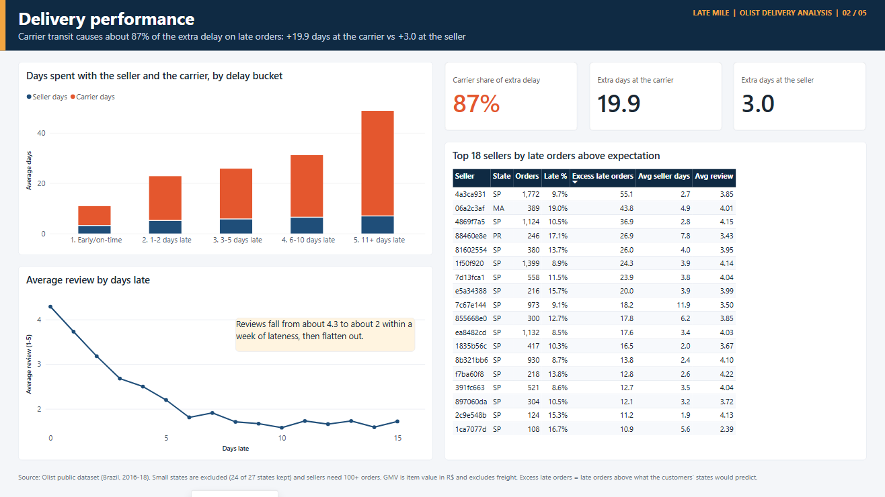
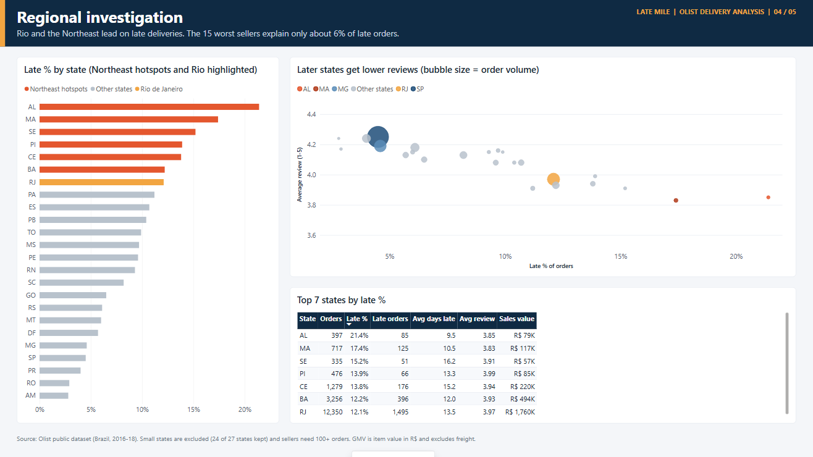

# Late Mile

**Why do Olist orders arrive late, and what does it cost in customer reviews?**
A SQL + Python + Power BI analysis of the Olist Brazilian e-commerce dataset (2016-18).

## Key findings
- **6.8%** of orders are delivered late.
- Late orders get a 1-star review about **8x as often** as on-time orders (average review 2.27 vs 4.29).
- About **87%** of the extra delay on late orders happens at the **carrier** stage (+19.9 days vs +3.0 at the seller).
- Three months (Nov 2017, Feb 2018, Mar 2018) hold 48% of all late orders.
- Rio de Janeiro (12.1% late on 12,350 orders) and the Northeast (AL, MA, SE, PI, CE, BA) are the hotspots.
- The 15 worst sellers explain only about 6% of late orders, so this is not mainly a seller problem.

## Dashboard (Power BI)

Open `dashboard/late_mile.pbip` in Power BI Desktop (Power BI Project format).
Point the data source at your local copy of `data/processed/`, then Refresh.

## Analysis
`notebooks/late_mile_analysis.ipynb` holds the full analysis in Python and DuckDB SQL:
- **Part A:** rebuilds the order-level table (`order_facts`, 96,470 delivered orders) from the raw Kaggle files.
- **Part B:** builds each dashboard table with SQL and checks it against the saved CSVs in `data/processed/` (all checks pass). Also includes window-function queries (RANK, LAG, running totals) and percentiles.
- **Part C:** recomputes every number shown on the dashboard (late rate, 1-star multiple, carrier share, spike months, seller concentration) with charts.

## Run it yourself
1. Download the [Olist dataset](https://www.kaggle.com/datasets/olistbr/brazilian-ecommerce) and put the 9 CSV files in `data/raw/`.
2. `pip install duckdb pandas matplotlib jupyter`
3. Open `notebooks/late_mile_analysis.ipynb` and run all cells.

## Recommendations
1. Fix the carrier stage first (review carrier performance and routing for long-distance states).
2. Alert when a month passes 10% late.
3. Focus on Rio de Janeiro and the Northeast.

## Limitations
- This shows association, not proof of cause. Late orders may also differ by product weight, distance or carrier.
- Repeat purchase is low (about 3%) and barely changes by delay, so no strong claim is made about it.
- "Expected late orders" for sellers controls for customer state only.
- Sales value is item value in R$, not lost revenue.
- Small states are excluded (24 of 27 kept) and sellers need 100+ orders.

## Data
[Olist Brazilian E-Commerce Public Dataset](https://www.kaggle.com/datasets/olistbr/brazilian-ecommerce) on Kaggle (CC BY-NC-SA 4.0). The raw files and the row-level `order_facts.csv` are not included. `data/processed/` holds the small summary tables behind the dashboard.
