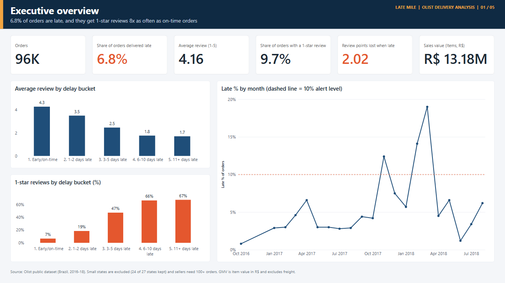
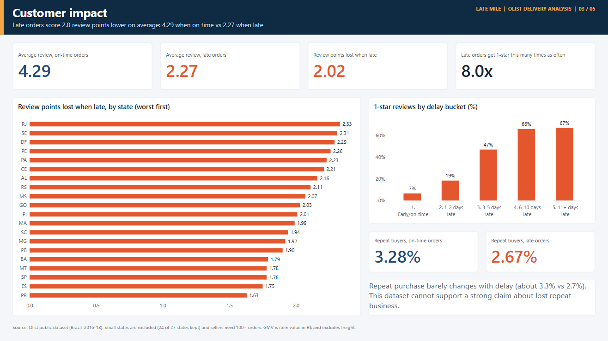
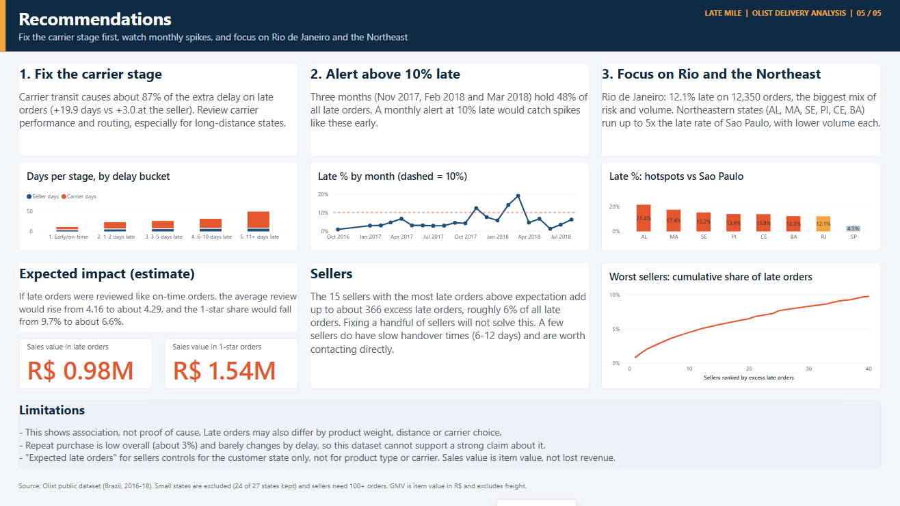

# Late Mile

**Orders that arrive late get 1-star reviews 8x as often. Where does the delay actually happen, and who should fix it?**

An end-to-end analysis of 96,470 delivered orders from the Olist Brazilian e-commerce dataset (2016-18), using **SQL (DuckDB), Python and a 5-page Power BI dashboard**.



## The answer in 30 seconds

| Question | Answer |
|---|---|
| How many orders are late? | **6.8%** |
| What does lateness cost in reviews? | Average review **4.29 on time vs 2.27 late** (2.02 points lost). 1-star reviews: **7% when on time, 67% when 11+ days late** |
| Where does the extra delay happen? | **87% at the carrier** (+19.9 days) and only 13% at the seller (+3.0 days) |
| Is it a few bad sellers? | **No.** The 15 worst sellers explain about **6%** of late orders (366 excess late orders) |
| When does it spike? | Three months (Nov 2017, Feb 2018, Mar 2018) hold **48%** of all late orders |
| Where is it worst? | **Rio de Janeiro** (12.1% late on 12,350 orders) and the **Northeast** (AL, MA, SE, PI, CE, BA), which run up to about 5x the late rate of Sao Paulo |
| What would fixing it be worth? | If late orders were reviewed like on-time orders: average review **4.16 to about 4.29**, 1-star share **9.7% to about 6.6%** (estimate, not proof) |

## The tempting story vs what the data says

The obvious assumption is that a handful of bad sellers cause late deliveries. The data points elsewhere:

- **Sellers are not the main stage.** Late orders lose about 20 extra days in carrier transit, against about 3 at the seller.
- **Sellers are not concentrated.** A cumulative chart of the worst sellers only reaches about 10% of late orders after 40 sellers.
- **The problem is geographic and seasonal.** It clusters in specific states and in three peak months, which points to carrier capacity and routing, not individual sellers.

So the recommendation is aimed at carriers and regions, with seller outreach as a smaller second step.

## What is in the dashboard

| Page | What it shows |
|---|---|
| 1. Executive overview | Headline KPIs, review score by delay bucket, late % by month with a 10% alert line |
| 2. Delivery performance | Seller days vs carrier days by delay bucket, review score by days late, top sellers by late orders above expectation |
| 3. Customer impact | Review points lost by state, 1-star rate by delay bucket, repeat purchase check |
| 4. Regional investigation | Late % by state with the Northeast and Rio highlighted, late % vs review score bubble chart, top 7 states table |
| 5. Recommendations | Three actions, each backed by a small chart, plus the expected impact and the limitations |

<details>
<summary>See all pages</summary>






</details>

## Design choices worth knowing

- **"Late" has a clear definition:** delivered after the promised date. Orders are bucketed from early/on-time to 11+ days late, so the damage can be seen to grow with each step.
- **Sellers are compared with what to expect.** A seller in a far-away state naturally has more late orders, so each seller's late orders are compared with the rate expected from their customers' states ("excess late orders"). This avoids blaming sellers for geography.
- **Small samples are excluded.** States with too few orders (3 of 27) and sellers with under 100 orders are left out so one or two orders can't swing a percentage.
- **Every chart has one job and a plain-English title.** Page headlines state the finding, not the topic.

## How I checked the numbers

`notebooks/late_mile_analysis.ipynb` is the full analysis in Python and DuckDB SQL:

- **Part A:** rebuilds the order-level table (`order_facts`) from the raw Kaggle files.
- **Part B:** rebuilds each dashboard table with SQL and compares it with the saved CSV in `data/processed/`. All five checkable tables print **PASS** with a largest difference of 0.000. This part also uses CTEs, window functions (RANK, LAG, running totals) and percentiles (`quantile_cont`).
- **Part C:** recomputes every number on the dashboard (late rate, 1-star multiple, carrier share, spike months, seller concentration) with charts.

The seller table needs the raw order-items and sellers files, so it is checked only when those are present.

## What this analysis does not claim

- **Association, not proof of cause.** Late orders may also differ by product weight, distance or carrier choice.
- **Repeat purchase:** repeat buying is low overall (about 3%) and barely changes with delay (3.3% on time vs 2.7% late), so the dataset cannot support a claim about lost repeat business.
- **Seller "expected late orders"** controls for the customer's state only, not for product type or carrier.
- **Sales value** is item value in R$ (freight excluded), not lost revenue.

## Skills shown

- **SQL (DuckDB):** CTEs, window functions, percentiles, EXISTS, date arithmetic, reconciliation checks
- **Python:** pandas, matplotlib, Jupyter, data validation
- **Power BI:** star-style model, DAX measures and calculated columns (RANKX, cumulative share), Power BI Project (PBIP) format, consistent theme and number formats
- **Analysis:** metric definitions, expected-vs-actual comparison, sample-size rules, stating limitations

## Repository

```
late-mile-olist/
  README.md
  notebooks/late_mile_analysis.ipynb   SQL + Python analysis, checks and charts
  dashboard/late_mile.pbip             Power BI Project (open in Power BI Desktop)
  data/processed/                      small summary tables behind the dashboard
  images/                              dashboard screenshots
```

## Run it yourself

1. Download the [Olist dataset](https://www.kaggle.com/datasets/olistbr/brazilian-ecommerce) and put the 9 CSV files in `data/raw/`.
2. `pip install duckdb pandas matplotlib jupyter`
3. Open `notebooks/late_mile_analysis.ipynb` and run all cells.

To explore the dashboard, open `dashboard/late_mile.pbip` in Power BI Desktop, point the data source at your local copy of `data/processed/`, then Refresh.

## Data

[Olist Brazilian E-Commerce Public Dataset](https://www.kaggle.com/datasets/olistbr/brazilian-ecommerce) on Kaggle (CC BY-NC-SA 4.0). The raw files and the row-level `order_facts.csv` are not included here. `data/processed/` holds the small summary tables behind the dashboard.
